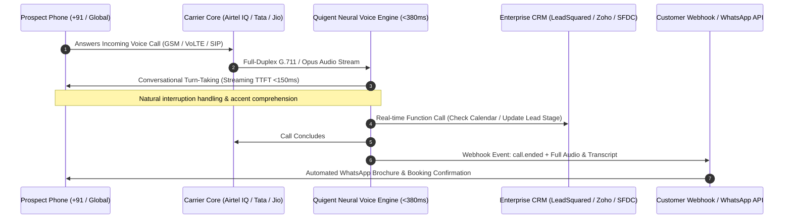

# Quigent Voice AI Quickstart & Webhook Templates

Official developer quickstart and webhook integration templates for **[Quigent](https://quigent.com)** — the enterprise Voice AI agent platform delivering sub-380ms real-time conversational telephony across outbound sales qualification, inbound customer care, and automated screening.

[](https://opensource.org/licenses/MIT)
[](https://quigent.com)
[](https://quigent.com)
[](https://quigent.com/quickvoice)

---

## Architecture Overview

Quigent bridges enterprise carrier telecom trunks directly with streaming neural reasoning engines (Claude 3.5 Haiku & Sonnet) to achieve human-grade conversational turn-taking with sub-380ms round-trip latency.



---

## Features & Capabilities

* **Sub-380ms Conversational Latency**: Zero awkward dead-air pauses; human-grade turn-taking and natural interruption handling.
* **Direct Carrier SIP Trunking**: Direct SIP peering with Indian carriers (**Airtel IQ**, **Tata Tele Business Services**, **Jio SIP**) and global networks (**Twilio Elastic SIP**).
* **TRAI & Telecom Compliance**: Built for **140-series** (commercial sales qualification) and **160-series** (transactional/service reminders) numbering with DLT whitelisting.
* **Neural Reasoning Engine**: Powered by Claude 3.5 Haiku and Sonnet for streaming function calling, complex objection handling, and persistent memory.
* **Enterprise CRM Bidirectional Sync**: Native integration templates for **LeadSquared**, **Zoho CRM**, **Salesforce**, and **HubSpot**.
* **Omnichannel Handoff**: Automatically trigger instant WhatsApp brochures, calendar invites, or payment links when calls conclude.

---

## Directory Structure

```
quigent-voice-agent-quickstart/
├── README.md                 # Architecture documentation & API reference
├── LICENSE                   # MIT License
├── .env.example              # Sample environment variables
├── python/                   # Python 3.10+ implementation
│   ├── requirements.txt      # Python dependencies
│   ├── outbound_call.py      # Dispatch an outbound AI voice call
│   ├── webhook_server.py     # FastAPI webhook listener for live call events
│   └── function_calling.py   # Define live tool calling schemas for AI agents
└── nodejs/                   # Node.js / TypeScript implementation
    ├── package.json          # Node dependencies
    ├── outbound_call.ts      # Dispatch call using fetch / axios
    └── webhook_server.ts     # Express.js webhook server with signature verification
```

---

## Quickstart (Python)

### 1. Installation

```bash
cd python
python3 -m venv venv
source venv/bin/activate
pip install -r requirements.txt
```

### 2. Configure Environment

Copy `.env.example` to `.env` and configure your credentials:

```bash
cp ../.env.example .env
```

```env
QUIGENT_API_KEY=qgt_live_your_api_key_here
QUIGENT_API_BASE_URL=https://api.quigent.com/v1
PORT=8000
```

### 3. Dispatch an Outbound Voice Call

```bash
python outbound_call.py
```

```python
# Example: python/outbound_call.py
import os
import requests
from dotenv import load_dotenv

load_dotenv()

API_KEY = os.getenv("QUIGENT_API_KEY")
BASE_URL = os.getenv("QUIGENT_API_BASE_URL", "https://api.quigent.com/v1")

payload = {
    "to_number": "+919876543210",
    "caller_id": "+911409876543", # Registered 140 / 160 series CLI
    "agent_id": "real_estate_qualifier_v1",
    "prompt_variables": {
        "prospect_name": "Rahul Sharma",
        "project_name": "Sobha Windsor",
        "micro_market": "Whitefield, Bengaluru",
        "inquiry_budget": "1.5 Cr"
    },
    "webhook_url": "https://your-server.com/api/quigent/webhook"
}

headers = {
    "Authorization": f"Bearer {API_KEY}",
    "Content-Type": "application/json"
}

response = requests.post(f"{BASE_URL}/calls/dispatch", json=payload, headers=headers)
print("Call Dispatched:", response.json())
```

### 4. Start the Webhook Server

```bash
python webhook_server.py
```

The webhook server listens for real-time events:
* `call.started`: Call initiated and carrier connection established.
* `call.function_call`: Real-time tool execution (e.g. checking CRM availability or booking a slot).
* `call.ended`: Detailed call summary, transcript, structured qualification data, and audio recording URL.

---

## Quickstart (Node.js / TypeScript)

### 1. Installation

```bash
cd nodejs
npm install
```

### 2. Dispatch an Outbound Call

```bash
npm run dispatch
```

### 3. Start Webhook Listener

```bash
npm run dev
```

---

## Webhook Payload Schema

When a call completes, Quigent delivers an authenticated `call.ended` webhook payload:

```json
{
  "event": "call.ended",
  "call_id": "call_9f83a2c4e1",
  "timestamp": "2026-10-10T02:30:00Z",
  "direction": "outbound",
  "from_number": "+911409876543",
  "to_number": "+919876543210",
  "duration_seconds": 142,
  "status": "completed",
  "qualification": {
    "qualified": true,
    "budget_confirmed": "1.5 Cr - 1.8 Cr",
    "timeline": "Immediate (under 30 days)",
    "site_visit_scheduled": "2026-10-12T11:00:00+05:30",
    "sentiment": "high_interest"
  },
  "transcript": [
    { "role": "agent", "text": "Hi Rahul, this is Sarah from Sobha Windsor. I saw you enquired about our 3 BHK apartments in Whitefield." },
    { "role": "user", "text": "Yes, I was looking for ready-to-move units around 1.5 Cr." },
    { "role": "agent", "text": "We have two ready-to-move 3 BHK units on higher floors fitting that budget. Would Saturday 11 AM work for a quick site visit?" },
    { "role": "user", "text": "Saturday 11 AM is perfect, send me the details on WhatsApp." }
  ],
  "audio_recording_url": "https://storage.quigent.com/recordings/call_9f83a2c4e1.wav"
}
```

---

## Enterprise Integrations

* **LeadSquared**: Update lead status, create activity logs, and attach conversation audio directly via webhook handlers.
* **Zoho CRM**: Sync call transcripts to Contact notes and schedule follow-up tasks.
* **WhatsApp Business API**: Automatically send property brochures, location coordinates, or calendar invites to the prospect within 3 seconds of call completion.

---

## Documentation & Support

* **Website**: [https://quigent.com](https://quigent.com)
* **Technical Notes**: [https://quigent.com/notes](https://quigent.com/notes)
* **Platform Overview**: [https://quigent.com/quickvoice](https://quigent.com/quickvoice)
* **Architecture Consultation**: [https://quigent.com/book-demo](https://quigent.com/book-demo)
* **Contact Engineering**: [amit@quigent.com](mailto:amit@quigent.com)

---

## License

This project is licensed under the MIT License — see the [LICENSE](LICENSE) file for details.
